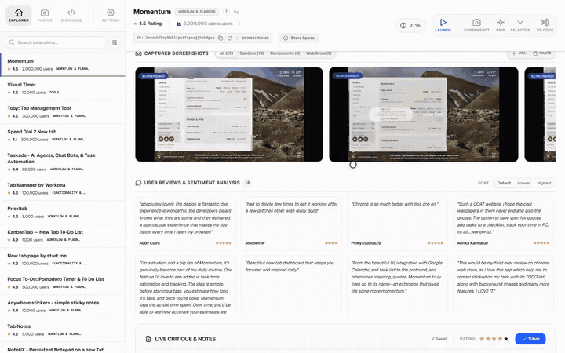

# Extension Explorer

**MV3 Extension Sandbox, Media Vault & Computed-CSS DOM Inspector** — a full-stack local workbench built with **React 19, Vite, Express 5, Tailwind CSS v4, and Playwright**.

Load Chrome extensions inside an isolated Playwright browser context, inspect store specifications and reviews, capture HUD screenshots, extract self-contained HTML + computed CSS component snippets, and preview rebuilt React components side-by-side with their source code.

---

## Demo Walkthrough



* **HD Video Asset:** [assets/extension-explorer.mp4](assets/extension-explorer.mp4) (18.2s, 1280×800 H.264)
* **Poster Preview:** [assets/extension-explorer.jpg](assets/extension-explorer.jpg)
* **Live Portfolio Showcase:** [rahulmehta.fyi/#demos](https://rahulmehta.fyi/#demos)

---

## Key Capabilities

* **Isolated Playwright Sandbox:** Boot headful Chromium sessions with extensions pre-loaded, detecting entry points (New Tab override, Popup, Options) automatically.
* **DOM Style & Component Extractor:** Injected browser script (`server/sniper/sniper_injected.js`) clones target DOM nodes, resolves active CSS variables, captures `::before`/`::after` pseudo-elements, and exports standalone HTML + scoped CSS snapshots.
* **Photos Vault (Bento Gallery):** Chronological masonry/list browser for captured screenshots and component crops with inline notes, category filters, and HTML/style code tabs.
* **Interactive Showcase Lab:** Split workspace pairing a live React component preview (`Grid`, `Dark`, `Light`, `Checker` canvas modes + original crop opacity compositor) with a synchronized JSX / raw HTML inspector.
* **Keyboard-First Navigation:** `Space` (audit timer toggle), `↑` / `↓` (navigate extension feed), `Ctrl + ↑` (launch sandbox), `Ctrl + Shift + S` (in-sandbox screenshot), `Ctrl + Shift + E` (toggle DOM element selector).

---

## Tech Stack

| Layer | Technologies |
| :--- | :--- |
| **Frontend** | React 19, Vite 8, Tailwind CSS v4, Framer Motion, Tabler Icons, EasyMDE, Sonner |
| **Backend** | Node.js, Express 5 |
| **Browser Automation** | Playwright (Chromium context isolation, injected DOM inspector, automated demo recorder) |
| **Media Tooling** | FFmpeg (automated `.mp4`, `.webm`, `.gif`, and poster pipeline via `scripts/record_demo.mjs`) |

---

## Quick Start

```bash
# 1. Install dependencies & Chromium for Playwright
npm install
npx playwright install chromium

# 2. Build the frontend bundle
npm run build

# 3. Start the unified Express API + static server (http://localhost:3000)
npm run server
```

For frontend development with hot reload alongside the Express API (`:3000` proxied by Vite):

```bash
# Terminal 1
npm run server

# Terminal 2
npm run dev
```

Re-record and encode the demo video assets into `assets/` using Playwright + FFmpeg:

```bash
npm run demo
```

---

## Project Structure

```text
extension-explorer/
├── assets/                   # Demo video, poster, and README preview assets
├── public/                   # Static icons and assets
├── scripts/
│   └── record_demo.mjs       # Playwright + FFmpeg automated walkthrough recorder
├── server/
│   ├── server.cjs            # Express 5 API, Playwright sandbox controller & file store
│   └── sniper/               # Injected DOM/CSS extractor script & backend handler
├── src/
│   ├── components/           # Sidebar, PhotosGallery, ShowcaseLab, SettingsModal
│   ├── pages/                # ExplorerPage, PhotosPage, ShowcasePage
│   └── App.jsx               # Root navigation & keyboard shortcuts
├── index.html
├── package.json
└── vite.config.js
```
